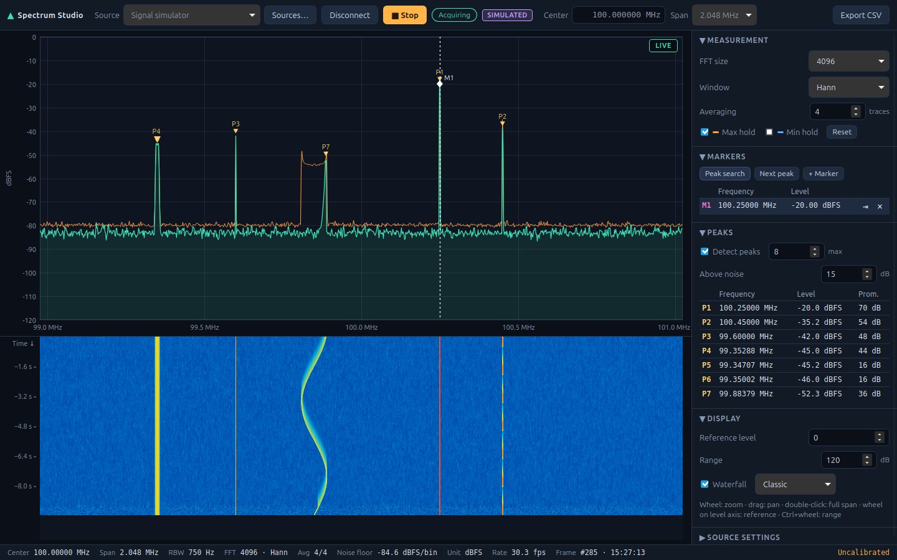

# Spectrum Studio

A local-first desktop spectrum analyzer for Linux. Connect a signal source, see its spectrum and
waterfall live, and measure peaks with markers. It works from day one without hardware thanks to a
built-in, repeatable signal simulator.



## Features

- **Sources:** built-in signal simulator (tones, noise, drifting/bursting/FM/swept signals,
  fault injection), IQ recordings (SigMF, raw cf32/cs16/cu8/cs8) and CSV spectrum traces. SDRs
  and bench analyzers are planned and listed as such. See [`docs/sources.md`](docs/sources.md).
- **Spectrum processing:** FFT 256–32768 points; Hann, rectangular, Blackman-Harris and flat-top
  windows; power averaging; max/min hold. Amplitudes are labelled in dBFS (uncalibrated), dBm
  only for calibrated data.
- **Analysis:** automatic peak detection with exact window-corrected frequency/amplitude, a peak
  table, up to four markers with delta readouts, peak search and marker → center.
- **Display:** live spectrum with zoom/pan, waterfall with time scale, crosshair readout,
  explicit LIVE / HOLD / stale indication so old data is never mistaken for current data.
- **Source management:** discovery, connection forms generated from driver descriptions, saved
  configurations, safe switching between sources, reconnect after failures.
- **Export:** CSV with frequency, levels, units and full measurement metadata.
- **Persistence:** preferences and saved sources survive restarts (`~/.config/io.github.spectrumstudio`).

## Quick start

Prerequisites (Linux Mint 22 / Ubuntu 24.04):

```sh
sudo apt install build-essential curl libwebkit2gtk-4.1-dev libxdo-dev libssl-dev \
  libayatana-appindicator3-dev librsvg2-dev
# Rust ≥ 1.94 via https://rustup.rs and Node.js ≥ 22
```

Run in development mode:

```sh
npm install
npm run tauri dev
```

Then press **▶ Run**: the simulator is selected by default.

Build installable packages (`.deb` and AppImage) into `target/release/bundle/`:

```sh
npm run tauri build
```

## Documentation

| Topic | Document |
| --- | --- |
| Using the application | [docs/user-guide.md](docs/user-guide.md) |
| Architecture and module boundaries | [docs/architecture.md](docs/architecture.md) |
| Signal processing, units and accuracy | [docs/dsp.md](docs/dsp.md) |
| Source model and adding integrations | [docs/sources.md](docs/sources.md) |
| Supported file formats | [docs/file-formats.md](docs/file-formats.md) |
| Development setup, commands, packaging | [docs/development.md](docs/development.md) |
| Testing strategy and running tests | [docs/testing.md](docs/testing.md) |
| Engineering guidelines | [docs/guidelines.md](docs/guidelines.md) |
| Status and roadmap | [docs/roadmap.md](docs/roadmap.md) |
| Architecture decision records | [docs/adr/](docs/adr/) |

## License

MIT
