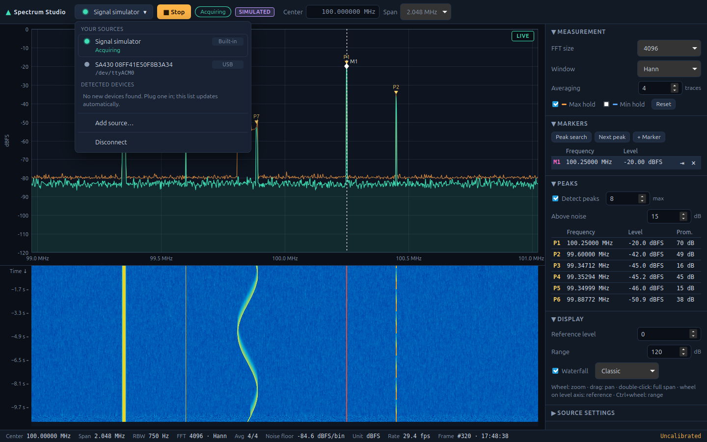
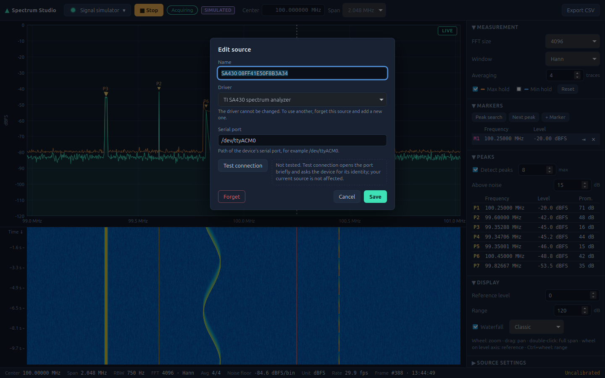

# User guide

## First run

1. Start Spectrum Studio. The source button at the left of the toolbar reads **Choose a source**
   and **▶ Run** is disabled until you pick one.
2. Click the source button (or press **Ctrl+K**) and choose **Signal simulator**. Picking a source
   connects to it; the state pill shows **Connected**.
3. Press **▶ Run**. The pill shows **Acquiring**, the plot shows **LIVE**, and a purple
   **SIMULATED** badge reminds you the data is generated.

## Toolbar

| Control | Purpose |
| --- | --- |
| Source button | Shows the status circle and name of the current source; opens the source menu (see *Choosing a source*). |
| ▶ Run / ■ Stop | Starts or stops acquisition. Run connects first if the selected source is not connected. |
| State pill | Authoritative backend state: Disconnected, Connecting…, Connected, Acquiring, Disconnecting…. |
| Center / Span | Tuning and span, enabled only when the source supports them. Center accepts `100.2M`, `433.92 MHz`, `2.4G`, `12k`; ↑/↓ step by a tenth of the span. Invalid input stays highlighted until corrected or Escape. |

## Choosing a source

There is no separate connect step: **picking a source in the menu connects to it** (the previous
source is stopped and released first). Open the menu by clicking the source button or with
**Ctrl+K**; navigate with the arrow keys, Home/End and Enter, close it with Escape.

Every row has the same layout: a **status circle**, the name, and a fixed-width badge for the kind
of source (**USB**, **Serial**, **Built-in**). A second line gives the status in words and where the
source is attached (the serial port). Long names are cut with an
ellipsis; hover the row for the full name and its details.

- **Your sources:** every source you have connected to or added, most recent first, with the
  settings it was last used with (centre, span and source settings are remembered
  automatically). **One physical device is always one row**, however many times you plugged it in
  or on which port: the row follows the device by its serial number.
  - **✎ Edit** (or **F2** on the focused row) opens the *Edit source* dialog (see below).
  - **× Forget** (or **Delete**) removes it from the list; an **Undo** appears for a few seconds. Forgetting the source you have selected but not connected clears the selection (the button reads "Choose a source"); a connected source stays connected until you pick another.
- **Detected devices:** hardware that is plugged in and not yet remembered. The menu looks for
  devices by itself while it is open; there is no Scan button. When nothing new is plugged in it
  says so. A detected row has **✎** too: it opens the dialog with the device filled in, and Save
  remembers it without connecting. A remembered device that is not currently plugged in is shown
  dimmed as **Not detected**.
- **Signal simulator:** listed until you have used it once, after which it is a normal entry
  under *Your sources*.
- **Add source…:** adds a source you set up by hand, for example an SA430 on a serial port you
  name (see *Add and edit a source*). Nothing is connected until you pick the new row.
- **Disconnect:** releases the current source but keeps it selected, so **Run** connects it again.

### Status circles

The circle at the left of every row, and on the source button, says the same as the words on the
second line; colour is never the only signal.

| Circle | Meaning |
| --- | --- |
| Solid green with a soft halo | Connected or acquiring |
| Solid grey | Remembered and available, not connected |
| Empty ring (grey outline) | *Not detected*: the device is not plugged in |
| Pulsing blue | Connecting or disconnecting |
| Red cross | *Failed*: the last attempt to use it failed (the reason is in the notice bar) |

Planned integrations that are not implemented yet are not shown in the menu at all; they cannot be
connected. See [roadmap.md](roadmap.md) for what is planned.

On the next start the last used source is selected again but never connected automatically.

### Add and edit a source

**Add source…** and **✎ Edit** open the same dialog.

1. **Name:** your own name for the source, 1 to 60 characters, unique (upper and lower case count
   as the same). When you add a device that answers the test, its automatic name (for example
   *SA430 08FF41E50F8B3A34*) is suggested if you left the field empty.
2. **Driver** (Add only): the kind of source to set up. Devices that are detected automatically do
   not need this. In Edit the driver cannot be changed; forget the source and add a new one.
3. **Connection** fields, for example the serial port of an SA430 (`/dev/ttyACM0`).
4. **Test connection** opens the port briefly and asks the device for its identity. It never
   disturbs the source that is connected right now. The result is `Connection OK` with the serial
   number, or the reason it failed. You can **still save an untested source**; the next attempt to
   connect will tell you whether it works. If a detected device is attached at that port, the
   source is bound to that device on Save, so it is still one row for one device.
5. **Save** remembers the source (and, in Edit, applies the change). It never connects. The saved
   row is highlighted for a moment.

Details:

- If the test finds a device that is already in *Your sources*, the dialog says so and Save is
  disabled: there is one row per device.
- If you edit an existing source and the tested serial differs from the one stored, a warning says
  that saving binds the source to the other device; the name and settings are kept.
- The simulator can only be renamed.
- While the source is connected, its connection fields are locked (disconnect to change them) but
  the name changes immediately and acquisition keeps running.
- **Forget** in the dialog does the same as the row's **×**, with the same **Undo**.

## Reading the display

- **Spectrum:** frequency on the horizontal axis, level on the vertical axis in the unit printed
  on the axis and in the status bar. Live trace in green, max hold orange, min hold blue.
- **Liveness badge** (top right): `LIVE` while frames arrive; `Waiting for data…`; `No data for
  N s` if acquisition stalls; `HOLD · last data hh:mm:ss` when stopped — the trace turns grey so
  retained data is never mistaken for a current measurement.
- **Waterfall:** one row per frame, newest at the top, colour-mapped with the same reference level
  and range as the spectrum. The left scale shows the age of rows. It is cleared when the view or
  colour scale changes, so rows always match the axis above.
- **Status bar:** the settings that produced the frame on screen — centre, span, RBW (equivalent
  noise bandwidth of one bin), FFT size and window, averaging progress, estimated noise floor per
  bin, unit, frame rate and timestamp. **Uncalibrated** is shown for dBFS/dB data.

### Mouse

| Action | Effect |
| --- | --- |
| Wheel over the plot | Zoom frequency around the cursor |
| Drag | Pan |
| Double-click | Back to the full span |
| Wheel over the level axis | Move the reference level |
| Ctrl + wheel | Change the displayed range |
| Click | Move the active marker (or create one) |
| Shift + click | Add a marker |
| Hover | Crosshair with frequency, cursor level and trace level |

Display zoom only changes what is shown. To change what is measured, use Center and Span.

## Measurement panel

- **FFT size:** more points → finer resolution (RBW = ENBW × sample rate / N) and a lower noise
  floor per bin, at the cost of slower updates for low sample rates.
- **Window:** Hann (default, good general purpose), Rectangular (best resolution, high leakage),
  Blackman-Harris (low leakage), Flat top (most accurate amplitudes). See [dsp.md](dsp.md).
- **Averaging:** number of traces averaged in the power domain (1 = off).
- **Max/Min hold** and **Reset**. Holds and averages restart automatically when the frequency
  axis changes.

FFT size and window are disabled for sources that supply measured traces.

## Markers and peaks

- **Peak search** puts the active marker on the strongest peak; **Next peak** walks down the list.
- Marker rows show frequency and the trace level there; markers 2–4 also show Δ to marker 1.
- **⇥** sets the centre frequency to the marker (tunable sources only).
- The **Peaks** table lists detected peaks with interpolated frequency, level and prominence.
  Click a row to highlight it and move the active marker to it. *Above noise* sets how far a
  peak must rise above the estimated noise floor.

## Simulator

Pick the simulator, then open *Source settings* in the side panel while connected. Every emitter has an absolute RF
frequency, so retuning moves signals across the display like a real receiver:

| Group | Default |
| --- | --- |
| Noise | −50 dBFS total complex white noise |
| Tone 1 / 2 / 3 | 100.25 MHz −20 dBFS, 99.6 MHz −42 dBFS, (off) 100.7 MHz −60 dBFS |
| Drifting carrier | 99.85 MHz ± 40 kHz, 8 s period, −48 dBFS |
| Bursts | 100.45 MHz, 1.5 s period, 30 % duty, −35 dBFS |
| FM carrier | 99.35 MHz, 4 kHz deviation, 1 kHz rate, −38 dBFS |
| Sweep | (off) chirp across 90 % of the span every 6 s, −45 dBFS |
| Testing | seed 1; *Simulate device loss after* N s (in Source settings, reached from the simulator entry under *Your sources*); *Fail to connect* (a connection option, only set by editing the remembered entry in `sources.json`, as used by the tests) |

The same seed and settings always produce the same samples.

## When things go wrong

- A failed connection shows a red notice with the reason; the state stays *Disconnected* and the source is marked *Failed* in the menu. A source that failed on its first attempt is not remembered.
- If a device disappears during acquisition, the source is closed, the notice says why, and
  **Reconnect** reopens the same configuration.
- Recoverable read errors stop acquisition and offer **Restart**.
- Invalid settings are rejected with an explanation; the previous settings stay in effect.
- Corrupt preference files are backed up (`*.corrupt-<time>.json`) and reset, with a notice.

## Where data is stored

`~/.config/io.github.spectrumstudio/preferences.json` (processing and display settings, the last
selected source) and `sources.json` (the sources you connected to or added, remembered together
with their last settings). A `sources.json` from an earlier version is upgraded the first time it
is loaded: duplicate records of one device are merged (your name is kept) and the old file is
kept next to it as `sources.pre-v3-<time>.json`.
Forgetting a source in the menu removes its entry; entries of integrations this version does not
offer are kept in the file untouched. Nothing is sent anywhere.
